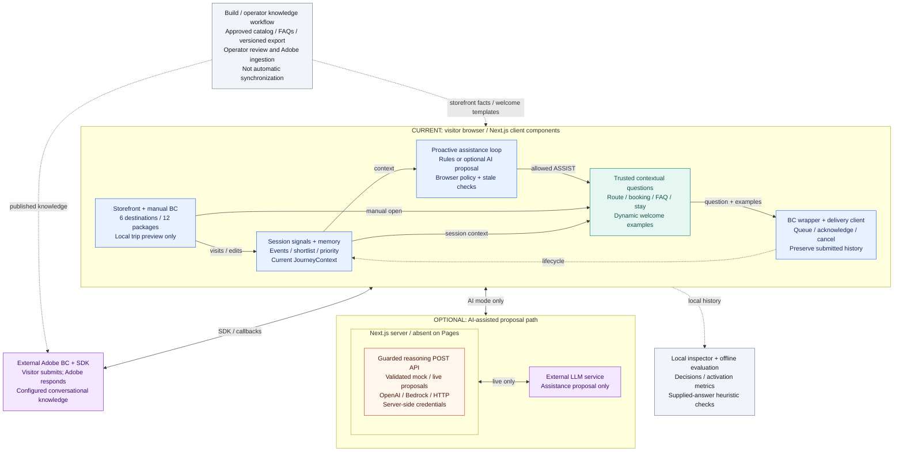
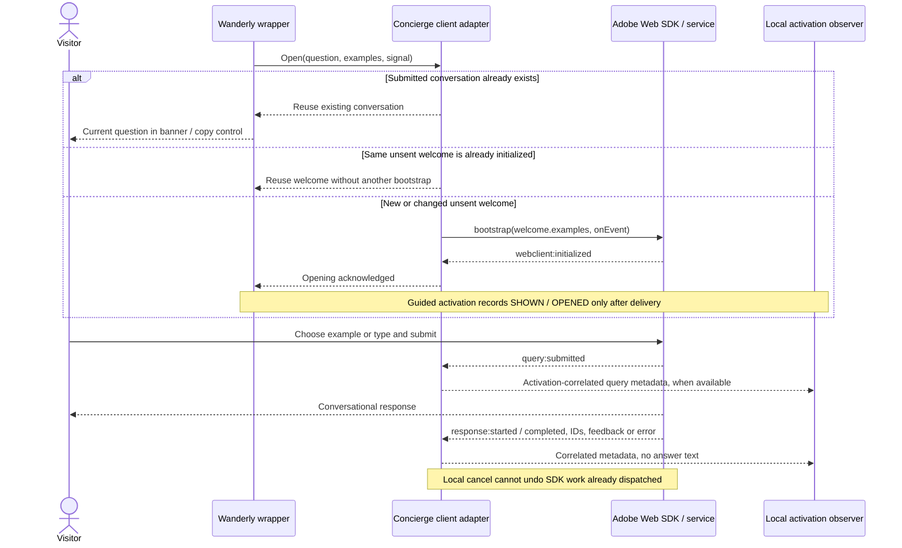

# Wanderly Adaptive Assistance: Current Technical Architecture

This document and its diagram describe the main-branch implementation from
November 2026. The `aaa-ai-showcase` branch also includes the AAA integration,
which is not represented in this snapshot.

Updated 24 November 2026 against the implemented POC. The overview below shows
existing components, not the previously proposed server-authoritative pilot.
The [landscape PNG](technical-architecture.png) is the 2560 x 1440 (16:9)
presentation version.

## 1. Current implementation overview

**Legend:** blue = current browser runtime; green = trusted contextual questions;
orange = implemented server capability requiring server hosting; purple = external
services; grey = local/build/operator workflows. Solid arrows show runtime or
workflow interactions; dotted arrows show supporting data and metadata flows.
External integration code does not prove that a live service or knowledge source
has been configured, ingested or quality-validated.

## 2. Two distinct entry paths

### Proactive assistance

1. [JourneyTracker](../components/JourneyTracker.tsx) and component actions record
   semantic browsing signals. Page views alone are not semantic assistance signals.
2. [ConciergePlugin](../components/ConciergePlugin.tsx) waits 1.2 seconds after
   relevant changes, builds JourneyContext and selects rules or AI-assisted mode.
3. [Proposal selection](../lib/activation-proposal.ts) returns a validated decision
   and a source: rules, AI mock, AI live, or rules fallback. AI failures use rules;
   an actual AI WAIT does not become a rules ASSIST.
4. The [browser policy gate](../lib/assistance-policy.ts) permits only an eligible
   ASSIST. Defaults are confidence >= 0.8, two delivered invitations per session
   and a 120-second post-dismissal cooldown. Pending invitations, forward booking
   progress, handled assistance types and repeated dismissals also block opening.
5. The plugin rejects obsolete results after context/session/mode changes, builds
   a trusted question and requests acknowledged delivery with an activation ID.
   Failure offers a manual retry; interrupted or uncertain submissions are not
   automatically replayed.

### Visitor-initiated opening

- The [manual launcher](../components/BrandConcierge.tsx) re-reads current-session
  events, route/query, comparison and explicitly chosen priority at each opening.
  It does not require a rules/AI proposal or the proactive policy gate.
- [Context selection](../lib/concierge-context.ts) uses the last eight meaningful
  browsing signals, approved catalog entities and current-visit boundaries.
  Direct booking links and validated form-edit snapshots scope questions to the
  visible destination/package; package-query navigation creates a new visit boundary.
- Current destination pages override unrelated history. Unscoped comparison
  activity uses the current shortlist; an empty comparison does not resurrect
  historical destinations.
- A fresh session uses general examples for all six destinations rather than
  inventing preferences. New session clears Wanderly browsing/comparison, not
  Adobe conversation history.
- Brand/SDK availability checks still apply. Explicit manual opening remains
  possible during booking progression; the unsupported electronics fixture and
  `/demo/live` are not live Wanderly BC surfaces.

## 3. What actually crosses the Adobe boundary

The [client adapter](../lib/brand-concierge-client.ts) serializes opening requests,
deduplicates an unchanged welcome and invalidates queued work on cancellation.
Bootstrap receives the trusted primary question and catalog/template alternatives
through Adobe's documented `arrays["welcome.examples"]`.

- Default opening does **not** submit a visitor message or send a hidden journey
  payload. Raw browsing history, booking dates, party details and policy evidence
  do not enter the welcome questions.
- Changes refresh an **unsent** welcome on reopening/destination navigation.
  Same-page clicks do not continually reset an open input. Once a conversation
  has been submitted, the latest question appears in Wanderly's banner/copy
  control; Adobe history and the existing welcome are not rebootstrapped.
- The legacy `NEXT_PUBLIC_BC_LEGACY_AUTO_SUBMIT=true` path is build-time opt-in and
  relies on an undocumented initial-message attribute. Its matching-query
  acknowledgement and unknown-outcome replay protection are not a default
  supported Adobe send API.

## 4. Deployment and authority boundaries

| Deployment | Available runtime | Important boundary |
| --- | --- | --- |
| GitHub Pages | Static Next.js export, client query selection, local rules/policy/state and external BC SDK | No `/api/assistance/reason` server. Use rules mode; selecting AI without an endpoint falls back to rules. |
| Node/serverless-capable Next.js host | Same UI plus guarded reasoning POST endpoint and mock/live provider adapters | AI proposes; the browser still applies execution policy. No server-authoritative activation token or durable policy budget exists. |

The [Pages workflow](../.github/workflows/nextjs.yml) uses Node 22 and static export,
with client-side query readers inside Suspense boundaries. The
[Next configuration](../next.config.mjs) retains a normal server build when static
export is not selected. The browser uses a same-origin reasoning URL; a separately
hosted reasoning service is not currently wired into the static deployment.

Current timeouts are separate: the browser AI request is 8 seconds, live provider
requests are 15 seconds, and BC opening acknowledgement is 12 seconds. They are
not one coordinated end-to-end deadline.

## 5. Data, knowledge and evidence

| Responsibility | Current implementation |
| --- | --- |
| Browsing/session state | [Tracking](../lib/tracking.ts): localStorage retains the latest 300 events across sessions; sessionStorage identifies the current tab/session. Comparison is tab-local; mode/policy settings persist locally. This is capped history, not a durable store or a time-based retention policy. |
| Explicit preferences and restraint | [Session memory](../lib/assistance-memory.ts) derives chosen priority, accepted types and visitor dismissals from current-session events. It is not inferred demographic personalization or model learning. |
| Catalog and knowledge preparation | [Knowledge generation](../lib/concierge-knowledge.ts) produces a content hash, approved catalog/FAQ page and CSV of public URLs. Operators must review, publish and ingest/reprocess this knowledge in Adobe; deploying the site is not automatic knowledge synchronization. |
| Local visibility | [Outcome summaries](../lib/assistance-outcomes.ts) and presenter views distinguish requested, opened, failed, cancelled, submitted, response completion and later progression. Progression is correlation, not causal conversion uplift. |
| SDK metadata | [Observer/router](../lib/concierge-observer.ts) correlates activation/conversation/interaction IDs and suppresses ambiguous attribution. It stores no raw query, answer or feedback note. Pure manual launcher openings do not currently create their own activation IDs, so manual-only analytics are not comprehensive. |
| Offline quality checks | [Answer evaluator](../evaluation/evaluate-concierge.ts) checks supplied, approved test responses heuristically. SDK completion callbacks do not expose answer text; this is not live semantic answer validation. |
| Booking | [Planner](../components/BookingPlanner.tsx) prepares a local demo request preview. No reservation, live availability, payment or request transmission is implemented. |

Wanderly event tracking is browser-local, not a warehouse/AEP ingestion pipeline.
Adobe Web SDK traffic is a separate external boundary; its initialization currently
uses `defaultConsent: 'in'`. Consent orchestration and governed retention must be
designed before a real pilot rather than described as already implemented.

## 6. Future pilot changes - not part of the current diagram

- Server-authoritative eligibility, activation authorization, expiry/idempotency
  and durable session/budget state. Browser policy currently protects UX, not a
  trusted server execution boundary.
- Coordinated deadlines, stronger operational controls and centrally ingested
  outcomes, including independent attribution for manual openings.
- Consent/retention governance and an approved knowledge-publication workflow.
- Configured live-provider/Adobe acceptance tests, authorized answer-quality
  evidence and controlled experiments before claiming service reliability or uplift.

Wanderly owns observation, intervention timing, trusted questions and delivery
coordination. Adobe owns conversational answers over externally configured
knowledge. The current loop is bounded and event-driven, not autonomous booking
or a self-training agent.
