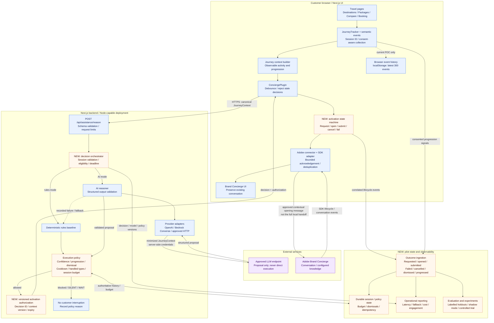

# Wanderly Adaptive Assistance: Technical Architecture

This is the proposed pilot architecture, not a claim that every component is deployed.
The current POC runs journey tracking, context construction and execution policy in
the browser. The target adds server-authoritative policy/state and acknowledged
activation while retaining the existing rules, provider and Adobe integration boundaries.

## Legend and implementation boundaries

- **Blue:** existing POC building blocks; integration presence does not establish live-service reliability.
- **Orange / dashed:** planned capability or placement. The policy algorithm already exists, but moving its authority to the backend is proposed.
- **Purple:** external services. Live provider and Adobe capabilities depend on approved configuration.
- **Solid arrows:** intended runtime interactions. **Dotted arrows:** fallback or current browser-only storage.

## Key contracts

1. **Proposal:** validated `SILENT / WAIT / ASSIST`, confidence, assistance type and observable evidence.
2. **Authorization:** proposed decision/activation IDs, context version and expiry; the browser rechecks session, route and progression before opening.
3. **Execution acknowledgement:** distinguish opening from actual message submission; match the callback, apply a timeout and cancel obsolete requests.
4. **Outcomes:** correlate lifecycle and progression using IDs. Automatic opening is not visitor acceptance; progression is not proof of causal uplift.

## Deployment and data constraints

- Keep this as a modular Next.js application initially; separate services only when scaling or ownership requires them.
- Use Node/serverless-capable hosting for the live reasoning API. GitHub Pages can host a static/mock showcase, not the server endpoint.
- LLM credentials remain server-side. Send only approved context to the reasoner and approved opening-message content to Adobe.
- Govern consent, retention and brand configuration before a pilot. Default operational telemetry to metadata rather than raw journeys or conversations.
- Do not duplicate Adobe's conversational answer system; Wanderly owns intervention timing, policy and activation orchestration.
